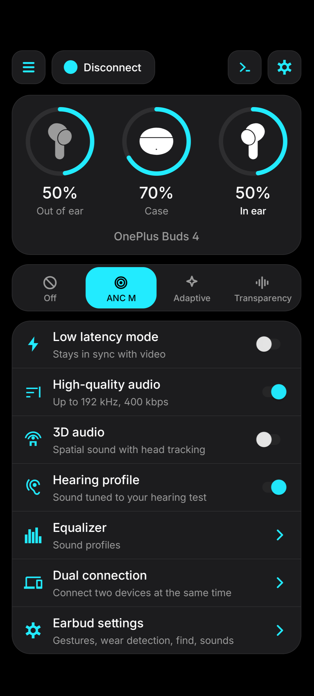
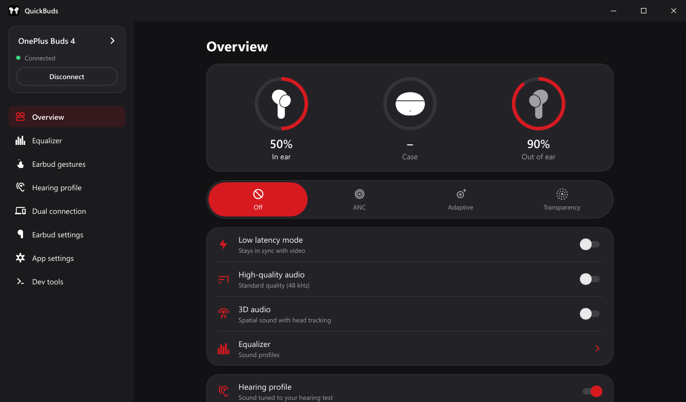
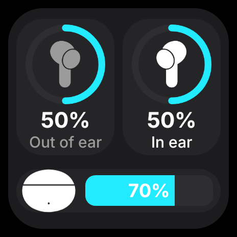
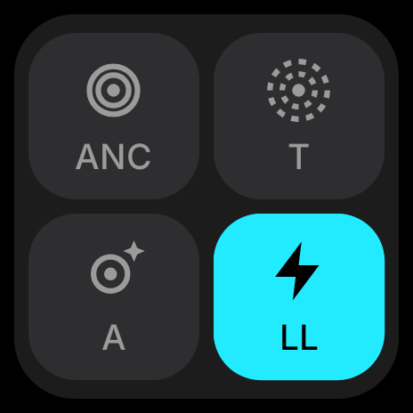
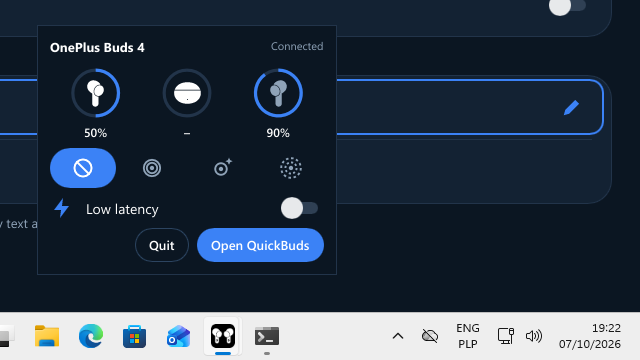
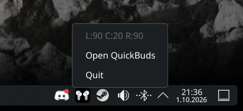

<div align="center">

# QuickBuds

**An alternative to HeyMelody and realme Link for your OnePlus, OPPO and realme earbuds.**

Android · Windows · Linux

[](./LICENSE)
[](#install)
[](https://github.com/spizganed/QuickBuds/releases/latest)
[](https://ko-fi.com/spizganed)
[](https://discord.gg/pvsnEf9TrZ)

 &nbsp; 

</div>

QuickBuds is an open-source alternative to HeyMelody and realme Link. It talks to your earbuds over
Bluetooth and shows the controls that your model has: on the phone with real home screen widgets, and on
the PC with a tray icon. It is a hobby project; you can support it on [Ko-fi](https://ko-fi.com/spizganed).

## Install

Pair your earbuds in the system's Bluetooth settings first. QuickBuds connects to paired earbuds; it does not pair them.

| Platform | How |
| --- | --- |
| **Android 8+** | Install `QuickBuds<version>.apk` from the [latest release](https://github.com/spizganed/QuickBuds/releases/latest). Allow the Bluetooth permission when asked. |
| **Windows 10 / 11** | Unzip `QuickBuds<version>-windows-x64.zip` and run `quickbuds.exe`. It is portable: no installer, no drivers, no background service. |
| **Linux** | Run the command below. It needs only `curl` and BlueZ. |

```sh
curl -fsSL https://raw.githubusercontent.com/spizganed/QuickBuds/main/scripts/install-linux.sh | sh
```

The command puts the AppImage in `~/.local/share/quickbuds`, adds a `quickbuds` command and a menu entry, and needs no administrator rights.
The app updates itself. To remove it, run the same script with `uninstall`:
`curl -fsSL https://raw.githubusercontent.com/spizganed/QuickBuds/main/scripts/install-linux.sh | sh -s uninstall`.
If you prefer, download `QuickBuds-linux-x64.AppImage` or the tarball `QuickBuds<version>-linux-x64.tar.gz` from the release. The tarball needs BlueZ, GTK 3 and libayatana-appindicator.

> **Got the APK somewhere else?** The only official downloads are the GitHub releases. A copy from
> another site is genuine only if it is signed with this certificate (SHA-256), which
> `apksigner verify --print-certs <apk>` shows:
> `9ae0ea888079cbd86af5a24391cd351af4a81fc04ebe9bd8429074c736249f61`

## What it does

| | |
| --- | --- |
| **Battery and wear** | Each bud and the case, live. |
| **Noise control** | Off, Noise cancelling (Low, Medium, High, Smart), Adaptive, Transparency. |
| **Sound** | Equalizer with presets, custom curves and bass boost. High-quality audio, 3D audio, low latency mode. |
| **Hearing** | A hearing test that tunes the sound to your ears, and a fit test of the ear-tip seal. |
| **Controls** | Gestures per bud, wear detection, dual connection, find my earbuds, prompt volume, tap sensitivity, firmware version. |
| **Per model** | QuickBuds reads the model and shows only what that model supports. Settings, Known issues lists the limits of your model and phone, and the app tells you once when your model has some. |
| **Android** | Home screen widgets from 2×2 up: the battery first, then the noise control and switches after a double tap. A ten-page setup guide. A game equalizer that follows the game in the foreground (needs Usage access). |
| **PC** | A tray icon with quick controls (Windows) or a battery menu (Linux). |
| **Looks** | Material, QuickBuds, Pixel art and Glass styles. OLED Black, Classic Dark and White themes, wallpaper colours, your own accent and palettes. Glass has six backgrounds. The phone and its widgets have all four styles; the PC app has the first three. |
| **Feedback** | Settings, Feedback sends a description, a model test or a crash report with the log, without a GitHub account. The developer can answer a report, and the answer shows once in the app. |
| **Languages and updates** | 27 languages, switchable in the app. Updates from GitHub releases; the PC app updates itself. |

<div align="center">

| Widget: battery | Widget: noise control | Tray: Windows | Tray: Linux |
| :---: | :---: | :---: | :---: |
|  |  |  |  |

</div>

## Supported earbuds

QuickBuds works on **any Android 8+ phone** (Samsung, Google Pixel, Xiaomi, Nothing, Motorola, OnePlus…),
not only on OnePlus / OPPO phones. It knows every earbud in HeyMelody's and realme Link's lists, 140 in
all, and shows only the features each one has. Each model also lists its known issues in Settings.

<details><summary><b>Confirmed</b> (27 models)</summary>

<details><summary><b>OnePlus</b> (8)</summary>

- **OnePlus Buds 4**: fully working. Every feature is tested on a Nothing Phone (3a), Android 16, and on Windows and Linux.
- **OnePlus Buds Pro 3**: confirmed by its owner on Android: battery, noise control, high-quality audio, 3D audio, hearing profile, equalizer, dual connection, gestures, wear detection, find my earbuds.
- **OnePlus Buds 3**: confirmed by its owner on Android and Windows: battery, noise control, 3D audio, hearing profile, equalizer, dual connection, gestures, wear detection, find my earbuds.
- **OnePlus Nord Buds 3**: confirmed by its owner on Android and Linux: battery, noise control, low latency, 3D audio, hearing profile, equalizer, dual connection, gestures, find my earbuds.
- **OnePlus Nord Buds 3 Pro**: confirmed by its owner on Android: battery, noise control, low latency, high-quality audio, hearing profile, equalizer, dual connection, gestures, wear detection, find my earbuds.
- **OnePlus Nord Buds 3r**: confirmed by its owner on Android: battery, low latency, 3D audio, equalizer, dual connection, gestures, find my earbuds.
- **OnePlus Buds Ace**: confirmed by its owner on Android: noise control, low latency.
- **OnePlus Bullets Wireless Z3**: confirmed by its owner on Android: 3D audio, equalizer.

</details>

<details><summary><b>OPPO</b> (5)</summary>

- **OPPO Enco Buds2**: confirmed by its owner on Windows: battery, low latency, equalizer, gestures.
- **OPPO Enco X**: confirmed by its owner on Android: battery, noise control, high-quality audio, hearing profile, equalizer, gestures, wear detection, find my earbuds.
- **OPPO Enco Air3 Pro**: confirmed by its owner on Android: battery, noise control, low latency, high-quality audio, 3D audio, hearing profile, equalizer, dual connection, gestures, wear detection, find my earbuds.
- **OPPO Enco Air5**: confirmed by its owner on Windows and Linux: battery, noise control, low latency, 3D audio, hearing profile, equalizer, dual connection, gestures, wear detection, find my earbuds.
- **OPPO Enco Air5 Pro**: confirmed by its owner on Windows: battery, noise control, 3D audio, dual connection, gestures, find my earbuds.

</details>

<details><summary><b>realme</b> (14)</summary>

- **realme Buds Air6 Pro**: confirmed by its owner on Android and Windows: battery, noise control, low latency, 3D audio, hearing profile, equalizer, dual connection, gestures, find my earbuds.
- **realme Buds Air6**: confirmed by its owner on Android: battery, noise control, low latency, high-quality audio, equalizer, dual connection, wear detection, find my earbuds.
- **realme Buds Air7**: confirmed by its owner on Android: battery, noise control, low latency, high-quality audio, 3D audio, hearing profile, equalizer, dual connection, gestures, wear detection, find my earbuds.
- **realme Buds Air7 Pro**: confirmed by its owner on Android and Windows: battery, noise control, wind noise reduction, low latency, high-quality audio, 3D audio, hearing profile, equalizer, gestures, wear detection, find my earbuds.
- **realme Buds Air8**: confirmed by its owner on Android: battery, noise control, low latency, high-quality audio, 3D audio, hearing profile, equalizer, dual connection, gestures, wear detection, find my earbuds.
- **realme Buds Air8 Pro**: confirmed by its owner on Android: battery, noise control, low latency, high-quality audio, hearing profile, dual connection, gestures, wear detection.
- **realme Buds Air 5 Pro**: confirmed by its owner on Android: noise control and the feature switches, read back from the buds.
- **realme Buds Wireless 3**: confirmed by its owner on Android: battery, noise control, low latency, high-quality audio, 3D audio, hearing profile, equalizer, dual connection, wear detection.
- **realme Buds T100**: confirmed by its owner on Android: battery, low latency, hearing profile.
- **realme Buds T200**: confirmed by its owner on Android: battery, noise control, low latency, high-quality audio, 3D audio, hearing profile, equalizer, dual connection, gestures, wear detection, find my earbuds.
- **realme Buds T200x**: confirmed by its owner on Android: battery, noise control, low latency, equalizer, dual connection, gestures.
- **realme Buds T310**: confirmed by its owner on Android: battery, noise control, low latency.
- **realme Buds T500 Pro**: confirmed by its owner on Android: battery, noise control, low latency, high-quality audio, 3D audio, hearing profile, equalizer, dual connection, gestures, wear detection, find my earbuds.
- **realme Cobble Speaker**: confirmed by its owner on Android: battery, low latency.

</details>

</details>

<details><summary><b>Not confirmed yet</b> (113 models)</summary>

Detected, with features built from HeyMelody's and realme Link's data. Some may not work.

<details><summary><b>OnePlus</b> (24 models)</summary>

OnePlus Bullets Wireless Z2, OnePlus BulletsWireless Z2 ANC, OnePlus Buds, OnePlus Buds Z, OnePlus Buds Pro, OnePlus Buds Z2, OnePlus Nord Buds, OnePlus Buds N, OnePlus Nord Buds CE, OnePlus Buds Pro 2, OnePlus Nord Buds 2, OnePlus Nord Buds 2r, OnePlus Buds Pro 2（轻享版）, OnePlus Buds Pro 2R, OnePlus Buds V, OnePlus Buds Ace 2, OnePlus Open Buds, OnePlus Buds 3V, OnePlus Buds Ace 3, OnePlus Nord Buds 4 Pro, OnePlus Nord Buds 4, OnePlus Flow Buds, OnePlus Buds Pro 4, OnePlus Buds Clip.

</details>

<details><summary><b>OPPO</b> (53 models)</summary>

OPPO Enco Quiet, OPPO Enco M31, OPPO Enco M32, OPPO Enco M33, OPPO Enco Free, OPPO O-Free, OPPO Enco W31, OPPO Enco W51, OPPO Enco W11, OPPO Enco Air, OPPO Enco Play, OPPO Enco Free2, OPPO Enco Buds, OPPO Enco Air Lite, OPPO Enco W31 Lite, OPPO Enco R, OPPO Enco Air2, OPPO Enco Air2 Pro, OPPO Enco X2, OPPO Enco Free2i, OPPO Enco Air2i, OPPO Enco Air3, OPPO Enco R Pro, OPPO Enco R2, OPPO Enco Free3, OPPO Enco X3i, OPPO Enco Air2（新声版）, OPPO Enco Air3i, OPPO Enco X3, OPPO Enco Air3s, OPPO Enco Air4 Pro, OPPO Enco Buds2 Pro, OPPO Enco R3, OPPO Enco Air 3i, OPPO Enco Free4, OPPO Enco Air4, OPPO Enco Air4i, OPPO Enco R3 Pro, OPPO Enco Buds3 Pro+, OPPO Enco Buds3, OPPO Enco Buds3 Pro, OPPO Enco R4, OPPO Enco Air4（新声版）, OPPO Enco R5, OPPO Enco Clip, OPPO Enco X3s, OPPO Enco Free4（丹拿版）, OPPO Enco Air5s, OPPO Enco Clip2, OPPO Enco Air5s（星光版）, OPPO Enco X4, OPPO Enco Air4s, OPPO Enco Buds3s.

</details>

<details><summary><b>realme</b> (33 models)</summary>

realme Buds Wireless 2S, realme Buds Wireless 3 Neo, realme Buds Wireless 5 ANC, realme Buds Wireless 6 Neo, realme Buds Wireless 6, realme Buds Wireless 6 ANC, realme Buds Air 3, realme Buds Q2s, realme Buds Air 3S, realme Buds Air 3 Neo, realme Buds Air 5, realme Buds T300, realme Buds T110, realme Buds N1 Pro, realme Buds N1, realme Buds T01, realme Buds T200 Lite, realme Buds Clip, realme TechLife Buds, realme Buds T500, realme Buds T500 Pro Harry Potter Edition, realme TechLife Buds T500 Pro, realme Buds Air 2 Neo, realme Buds Air, realme Buds Q2, realme Buds Air Pro, realme Brick Speaker, realme Buds Air 2, realme Buds Wireless 2, realme Buds Wireless 2 Neo, realme Pocket Speaker, realme Buds Wireless Pro, realme Buds Air Neo.

</details>

<details><summary><b>DIZO</b> (3 models)</summary>

DIZO Wireless, DIZO GoPods D, DIZO GoPods.

</details>

</details>

**Own other buds? Please tell us what works.** In the app, Settings › Test my earbuds (desktop: App
settings) reconnects the buds, lets you mark each feature, and sends the result with the log. The app
offers this test once, after the first connect to a model that is not confirmed. Settings › Feedback
sends a description and the log, without a GitHub account. Or open an
[issue](https://github.com/spizganed/QuickBuds/issues); [CONTRIBUTING.md](./docs/CONTRIBUTING.md#reporting-a-model)
says what to include. Each report lets the next release fix that model.
The developer can answer a report: the answer shows once in the app, on the next daily count (see Privacy).
To talk to the developer and other owners, join the [Discord server](https://discord.gg/pvsnEf9TrZ).

## For developers

- [CONTRIBUTING.md](./docs/CONTRIBUTING.md): build, tests, translations, where things are, and the rules.
- [build-android.md](./docs/build-android.md) and [build-desktop.md](./docs/build-desktop.md): the build steps for each app.
- [report-worker/](./report-worker): the Cloudflare Worker behind Feedback, the daily count and the replies.
- [PACKET-CAPTURE.md](./docs/PACKET-CAPTURE.md): capturing the earbuds' traffic, HeyMelody's included.
- [PROTOCOL.md](./docs/PROTOCOL.md): the wire format, every claim tagged with its source. [PROTOCOL-LEGACY.md](./docs/PROTOCOL-LEGACY.md) is the layer that ships.
- [ROADMAP.md](./docs/ROADMAP.md): the plan, and the features decided against.

Everything to build and release QuickBuds is in this repository, except the signing key. If the
project stops, anyone can fork it and publish their own signed build.

## Credits

The first hints about the earbud protocol came from
[OppoPodsManager](https://github.com/Zhaoyi-ya/OppoPodsManager),
[Pods-Protocol-Reverse-Engineering](https://github.com/Star-ZER0/Pods-Protocol-Reverse-Engineering) and
[OppoPods](https://github.com/Leaf-lsgtky/OppoPods). Today every fact in [PROTOCOL.md](./docs/PROTOCOL.md) rests on a
capture from real hardware, on a test on a device, or on the HeyMelody and realme Link apps (studied for interoperability).

Built with [Slint](https://slint.dev) (GPLv3) and [tray-icon](https://github.com/tauri-apps/tray-icon) on the PC.
Fonts: [Doto](https://github.com/oliverlalan/Doto) and [Google Sans Flex](https://github.com/googlefonts/googlesans-flex),
both SIL Open Font License 1.1, licenses bundled in `app/src/main/assets/`.

## Privacy

Once a day QuickBuds sends its platform, its version number (for example "Android 5.0.0") and a random install ID to a Cloudflare Worker.
The Worker counts active installs with it. The ID ties to no device, account or address, and the app sends no earbud data.
The ID also lets the developer answer a report you sent: the answer comes back with the daily count. A problem report carries the same ID and is sent only when you send it. On Android, Settings > Count my install turns the daily count off
(then no reply can reach you), and About > Privacy > Reset install ID forgets the ID. On the PC, delete the `app_id` key in `settings.json`.
The Worker code is in [report-worker/](./report-worker).

## License

Copyright (C) 2026 spizganed

QuickBuds is free software under the GNU General Public License v3.0 or later, distributed without
any warranty; see [LICENSE](./LICENSE).

QuickBuds is an independent project, not affiliated with, endorsed by or sponsored by OnePlus, OPPO,
realme, HeyTap or any of their affiliates. OnePlus, OPPO, realme, HeyMelody and the earbud model names
are trademarks of their respective owners and are used here only to say which devices the app works
with. The protocol was studied only to make these earbuds work with this app.
